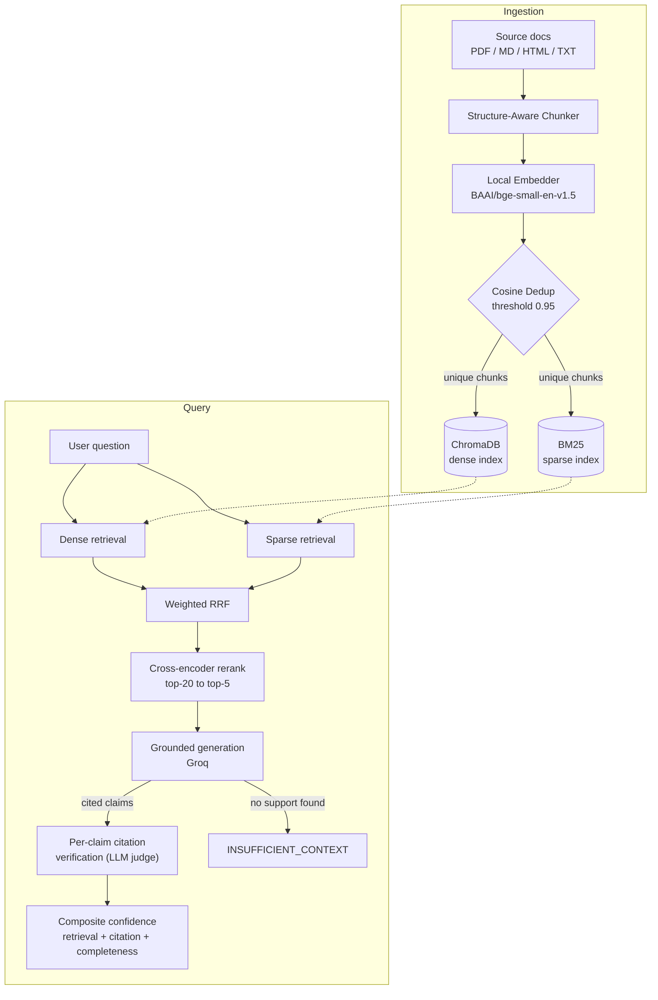

# Hybrid RAG Pipeline

**A production-hardened hybrid retrieval-augmented generation system** — dense + sparse retrieval fused and reranked, generation that must cite every claim or explicitly decline, independent per-claim citation verification, and a three-signal composite confidence score. Built and evaluated end-to-end against a real ~6,000-chunk technical corpus, not a toy dataset.


Most RAG demos stop at "retrieve some chunks, paste them into a prompt." This one treats grounding as something to be checked, not assumed: generation is forced into a cite-or-decline contract, every citation is re-verified by a separate model call against its actual source text, and the whole thing is scored, load-tested against a human-reviewed question set, logged, rate-limited, and containerized as a non-root service.

## Table of Contents

- [Overview](#overview)
- [Key Features](#key-features)
- [Architecture](#architecture)
- [Tech Stack](#tech-stack)
- [Project Structure](#project-structure)
- [Quickstart](#quickstart)
- [Configuration](#configuration)
- [API Reference](#api-reference)
- [Web Console](#web-console)
- [Evaluation Results](#evaluation-results)
- [Testing](#testing)
- [Security](#security)
- [Known Limitations](#known-limitations)
- [Roadmap](#roadmap)
- [License](#license)
- [Author](#author)

## Overview

The system ingests PDF, Markdown, HTML, and plaintext documents, chunks them with header awareness, embeds them locally, and indexes them in both a dense vector store (ChromaDB) and a sparse lexical index (BM25). At query time, it retrieves from both, fuses the results with weighted Reciprocal Rank Fusion, reranks with a cross-encoder, and generates an answer under a strict rule: every factual claim carries a citation, or the model responds with an explicit `INSUFFICIENT_CONTEXT` refusal instead of guessing.

Every claim in a generated answer is then independently re-verified — a second, separately-prompted call checks the claim against only its cited source text, with no visibility into the generation prompt or the model's own reasoning. The result is scored across three signals (retrieval strength, citation coverage, answer completeness) into one composite confidence number, and the whole pipeline is validated against a 37-question, human-reviewed golden set rather than being tuned against its own outputs.

It's exposed as a FastAPI service with API-key auth, per-IP rate limiting, structured observability logging with credential redaction, and a non-root Docker image — plus a zero-build vanilla JS console for interacting with all of it in a browser.

## Key Features

**Retrieval**
- Hybrid dense (ChromaDB, cosine similarity) + sparse (BM25) retrieval, combined with weighted Reciprocal Rank Fusion
- Cross-encoder reranking narrows the fused candidate pool (top-20) down to the final context (top-5)
- Structure-aware chunking that preserves Markdown/HTML header hierarchy per chunk (`Intro > Setup > Install`), with a size-based fallback for PDF and plaintext

**Grounded generation**
- Two-mode generation contract: cite every claim with a `[N]` marker, or explicitly decline with `INSUFFICIENT_CONTEXT` and a stated reason — no hedged partial answers
- The generation prompt explicitly instructs the model to treat retrieved excerpts as data to read, never as instructions to follow, as a prompt-injection defense against adversarial content inside ingested documents
- A single automatic retry if a response ships with zero citations in the required bracket format, with a fail-closed result if the retry also comes back uncited

**Verification & confidence**
- Per-claim citation verification: each claim is checked in isolation against the union of its cited chunks, by a call that never sees the generation prompt
- Composite confidence score averaging retrieval strength (sigmoid-scaled reranker score), citation coverage (fraction of claims verified as supported), and an LLM-judged completeness score

**Reliability & operations**
- Idempotent, checkpointed, resumable ingestion — deterministic chunk IDs, cosine-similarity dedup against both the current batch and the existing index, and safe-to-interrupt embedding with no re-work on restart
- Structured JSONL observability log (latency, confidence breakdown, errors) with regex- and known-secret-based credential redaction applied before anything is written
- Human-reviewed golden Q&A evaluation harness that runs every question through the live pipeline (not an offline scorer) and reports per-category behavior-match rates

**Security**
- Constant-time API-key auth, per-IP rate limiting, input length validation, non-root container execution, and Swagger/ReDoc disabled in production — see [Security](#security)

## Architecture



Every stage sits behind an interface — `Embedder`, `Reranker`, `Generator`, `CitationVerifier`, `CompletenessJudge` — with concrete providers wired through `config.py`. That abstraction paid for itself during development: the embedding provider changed three times (OpenAI, until the credits ran out; Gemini, until the free-tier rate limits made batch ingestion impractical; local `sentence-transformers`, which has no external limits at all) without touching any code outside the config and one new class per swap. After that settled, the unused providers (OpenAI, Gemini, and an evaluated Anthropic path) were removed entirely rather than left as dead branches — the interfaces stay generic, but only Groq (generation, verification, completeness judging) and local `sentence-transformers` (embeddings) are wired in today.

Fusion uses weighted RRF, not the unweighted textbook version: `score = dense_weight / (k + rank_dense) + sparse_weight / (k + rank_sparse)`, with defaults `k=60`, `dense_weight=0.7`, `sparse_weight=0.3`. The sparse side carries real weight rather than being a token gesture — the corpus is dense with exact technical terms (MCP, LangGraph, FastAPI) that a dense embedding can blur together but BM25 matches verbatim.

Generation, citation verification, and completeness judging currently run on the same underlying model (`GENERATION_MODEL`, via Groq) rather than three independent models — worth being direct about, since it means the verification step isn't a truly independent check in the adversarial sense. What it does provide is architectural isolation: the verifier call receives only the isolated claim and its cited source text, with no access to the generation prompt, the retrieved context set, or the model's own reasoning trace from the generation step. That's why it can catch obvious grounding failures even though it shares a model with the step it's checking; it's also why the [known leniency bias on compound claims](#known-limitations) is a real, documented limitation and not treated as a solved problem.

## Tech Stack

| Layer | Technology | Notes |
|---|---|---|
| API | FastAPI + Uvicorn | Async HTTP layer under `/v1/*` |
| Rate limiting | slowapi | Per-IP, per-endpoint limits set via env vars |
| Dense vector store | ChromaDB (persistent client) | Cosine similarity space, batched upserts |
| Sparse index | BM25Okapi (`rank-bm25`) | Full rebuild on every ingestion run |
| Reranking | sentence-transformers `CrossEncoder` | `cross-encoder/ms-marco-MiniLM-L-6-v2` |
| Embeddings | sentence-transformers | `BAAI/bge-small-en-v1.5`, 384-dim, local — CUDA if available |
| Generation / judging | Groq (`openai/gpt-oss-120b`) | Grounded generation, citation verification, completeness judging |
| Chunking | `langchain-text-splitters` | Header-aware splitting + recursive character fallback |
| Document parsing | `pypdf`, BeautifulSoup4 + lxml | PDF and HTML normalized to plain text / pseudo-Markdown |
| Config | `pydantic-settings` | `.env`-driven, one `Settings` object as the source of truth |
| Testing | pytest, pytest-cov | 230 tests, fakes for every external API |
| Container | Docker / Docker Compose | Non-root (UID/GID 10001), named volume for the HF model cache |

## Project Structure

```
src/rag/
├── config.py                  # Settings (pydantic-settings, .env-driven)
├── schemas.py                 # Document / Chunk / ScoredChunk data contracts
├── pipeline.py                 # run_ingestion() + answer_question() orchestration
├── observability.py            # Structured event logging, JSONL persistence, redaction
├── retry_utils.py              # Shared httpx / Groq RateLimitError retry helper
├── ingestion/
│   ├── loaders.py              # TXT / MD / HTML / PDF -> Document
│   └── chunking.py             # Structure-aware + fixed-size chunkers -> Chunk
├── indexing/
│   ├── embeddings.py           # Embedder interface + local sentence-transformers impl
│   ├── vector_store.py         # ChromaVectorStore (dense)
│   ├── sparse_index.py         # SparseIndex (BM25Okapi)
│   └── dedup.py                # Cosine-similarity near-duplicate detection
├── retrieval/
│   ├── dense.py / sparse.py    # Independently testable retrieval functions
│   ├── fusion.py                # Weighted Reciprocal Rank Fusion
│   └── reranker.py              # CrossEncoderReranker
├── generation/
│   ├── generator.py             # GroqGenerator - grounded, two-mode, citation-required
│   ├── verification.py          # Per-claim LLM-as-judge citation verification
│   ├── confidence.py            # Composite confidence scoring
│   └── text_utils.py            # Unicode punctuation normalization
├── eval/
│   ├── golden_qa.py             # Human-reviewed CSV loader, approval-gated
│   └── runner.py                 # Runs the golden set through the live pipeline
└── api/
    ├── dependencies.py          # DI container + API-key auth dependency
    └── main.py                  # FastAPI app: /v1/ask, /v1/ingest, /v1/documents, /v1/eval, /v1/observability

static/
├── index.html                  # Chat / Ingest / Documents / Eval / Observability tabs
├── app.js
└── style.css

tests/                          # 230 tests — fakes for external APIs, real Chroma + real BM25
eval/golden_qa_draft.csv        # Human-reviewed golden Q&A set (data, not code)
scripts/manual_check.py         # ingest / query / ask / eval - real-model validation CLI
Dockerfile
docker-compose.yml
requirements.txt / pyproject.toml
```

## Quickstart

**Prerequisites:** Python 3.11+, a free [Groq API key](https://console.groq.com) (no card required), and optionally Docker + Docker Compose. A CUDA GPU speeds up local embedding but isn't required.

### Local development

```bash
git clone https://github.com/BasuPatil09/Hybrid-RAG.git
cd Hybrid-RAG
python -m venv .venv

# Windows (PowerShell)
.venv\Scripts\Activate.ps1
# macOS / Linux
source .venv/bin/activate

pip install -e ".[dev]"
cp .env.example .env
# edit .env and set GROQ_API_KEY
```

No key is required for embeddings — local `sentence-transformers` runs on CPU by default in the shipped config, and auto-detects a CUDA GPU if `EMBEDDING_DEVICE` is set to `cuda` or `cuda:0`. Place your corpus (PDF / MD / HTML / TXT) under `./data/corpus/`, then:

```bash
python scripts/manual_check.py ingest
python scripts/manual_check.py ask "What is deep learning?"
python scripts/manual_check.py eval
```

`manual_check.py` is the real-model validation surface — it exercises actual embeddings, actual ChromaDB persistence, and actual Groq calls, which the automated test suite deliberately does not (see [Testing](#testing)).

### Docker

```bash
docker compose up --build
curl -X POST http://localhost:8000/v1/ingest -H "X-API-Key: $APP_API_KEY"
curl -X POST http://localhost:8000/v1/ask \
  -H "X-API-Key: $APP_API_KEY" -H "Content-Type: application/json" \
  -d '{"question": "What is deep learning?"}'
```

Open `http://localhost:8000` for the web console, or `http://localhost:8000/docs` for interactive Swagger (development only — see [Security](#security)). Place the corpus at `./data/corpus/` on the host; it's bind-mounted to `/app/data`, alongside the persistent Chroma database and the observability log, so all three survive container restarts. `./eval/` is mounted separately so the golden Q&A CSV can be reviewed or edited without rebuilding the image.

The shipped Dockerfile is CPU-only (`python:3.11-slim`, no CUDA runtime) — embeddings run on GPU only in local, non-Docker development, even on a machine with one available.

If ingestion or a request fails with a `PermissionError` on `data/` — typically because the directory was first created by an older, root-running version of the container — fix ownership from inside a container that already has the privilege to do it:

```bash
docker compose run --rm --user root app chown -R 10001:10001 /app/data
```

## Configuration

All settings are read from `.env` via `pydantic-settings`; any `Settings` field is overridable by its uppercase name as an environment variable, not just the ones below.

```env
GROQ_API_KEY=
APP_API_KEY=
ENVIRONMENT=development
ASK_RATE_LIMIT=30/minute
INGEST_RATE_LIMIT=6/hour
EVAL_RATE_LIMIT=2/hour
GENERATION_PROVIDER=groq
GENERATION_MODEL=openai/gpt-oss-120b
EMBEDDING_PROVIDER=local
EMBEDDING_MODEL=BAAI/bge-small-en-v1.5
EMBEDDING_DIMENSIONS=384
EMBEDDING_DEVICE=cpu
CHROMA_COLLECTION_NAME=rag_chunks
```

| Variable | Default | Description |
|---|---|---|
| `GROQ_API_KEY` | *(empty)* | Required for generation, verification, and completeness judging |
| `APP_API_KEY` | *(empty)* | Shared secret for `X-API-Key` auth on `/v1/*`; blank disables auth (local dev only) |
| `ENVIRONMENT` | `development` | `production` disables `/docs` and `/redoc` |
| `ASK_RATE_LIMIT` | `30/minute` | Per-IP limit on `POST /v1/ask` |
| `INGEST_RATE_LIMIT` | `6/hour` | Per-IP limit on `POST /v1/ingest` |
| `EVAL_RATE_LIMIT` | `2/hour` | Per-IP limit on `POST /v1/eval` |
| `GENERATION_PROVIDER` | `groq` | Only `groq` is currently wired |
| `GENERATION_MODEL` | `openai/gpt-oss-120b` | Shared by generation, verification, and completeness judging |
| `EMBEDDING_PROVIDER` | `local` | Only `local` (sentence-transformers) is currently wired |
| `EMBEDDING_MODEL` | `BAAI/bge-small-en-v1.5` | Hugging Face model id |
| `EMBEDDING_DIMENSIONS` | `384` | Must match the embedding model's output dimensionality |
| `EMBEDDING_DEVICE` | `cpu` | `cpu` / `cuda` / `cuda:0` — set explicitly for local GPU acceleration |
| `CHROMA_COLLECTION_NAME` | `rag_chunks` | ChromaDB collection name |

Pipeline tunables (retrieval, chunking, dedup) live in `config.py` with sensible defaults and aren't in `.env.example`, but follow the same env-var override convention:

| Setting | Default | Setting | Default |
|---|---|---|---|
| `chunk_size` / `chunk_overlap` | 800 / 120 | `dense_top_k` / `sparse_top_k` | 10 / 10 |
| `chunking_strategy` | `structure_aware` | `rrf_k` | 60 |
| `dedup_similarity_threshold` | 0.95 | `rrf_dense_weight` / `rrf_sparse_weight` | 0.7 / 0.3 |
| `rerank_top_n` | 5 | `ask_max_question_length` | 2000 |
| `ingestion_checkpoint_every` | 100 | `pdf_min_page_chars` | 20 |

## API Reference

| Method | Path | Auth | Rate Limit | Description |
|---|---|---|---|---|
| `GET` | `/health` | No | — | Liveness check, always public |
| `POST` | `/v1/ask` | Yes* | 30/min | Full retrieve → rerank → generate → verify → score pipeline |
| `POST` | `/v1/ingest` | Yes* | 6/hour | Load, chunk, embed, dedup, and index the corpus directory |
| `GET` | `/v1/documents` | Yes* | — | Chunk counts per indexed source |
| `POST` | `/v1/eval` | Yes* | 2/hour | Run the approved golden Q&A set through the live pipeline |
| `GET` | `/v1/observability` | Yes* | — | Recent request history + aggregate summary (`?limit=`) |
| `GET` | `/` | No | — | Static web console |

*Enforced via `X-API-Key`, only when `APP_API_KEY` is set.

`POST /v1/ask` response shape:

```json
{
  "query": "string",
  "answer": {
    "answer": "string, cited [1][2]... or an INSUFFICIENT_CONTEXT explanation",
    "is_insufficient": false,
    "cited_chunk_ids": ["source.pdf::p12::c3"]
  },
  "verified": {
    "claim_verdicts": [
      { "claim": "string", "chunk_ids": ["..."], "supported": true, "explanation": "string" }
    ]
  },
  "confidence": {
    "retrieval_confidence": 0.0,
    "citation_coverage": 0.0,
    "answer_completeness": 0.0,
    "composite": 0.0
  },
  "reranked": [{ "chunk": { "id": "...", "content": "...", "metadata": {} }, "score": 0.0 }]
}
```

`400` on an empty question, `422` over the configured max length, `503` if `GROQ_API_KEY` is unset or the index is empty, `429` over the per-IP rate limit. The full interactive schema is at `/docs` outside production.

## Web Console

A vanilla HTML/CSS/JS console, served as static files with no build step or frontend framework, with five tabs:

- **Chat** — ask a question, see the answer with a confidence breakdown (retrieval / citation coverage / completeness / composite), per-claim verification badges, and source chips distinguishing retrieved-but-not-cited from actually-cited chunks
- **Ingest** — one-button trigger with a report (documents loaded, chunks created, already indexed, duplicates skipped, total indexed) and a warning banner if a run stopped early
- **Documents** — live snapshot of indexed sources and chunk counts
- **Eval** — runs the golden set and shows summary cards, a per-category breakdown, and expandable per-question rows
- **Observability** — live traffic table (type, latency, composite confidence, detail) plus aggregate summary cards

API-key prompting is reactive: requests try without prompting first, and only a `401` triggers a browser prompt with a single retry, with the entered key cached in `sessionStorage` for that tab. It does not prompt on the public `/health` check.

## Evaluation Results

Real numbers from `python scripts/manual_check.py eval`, against the approved rows of `eval/golden_qa_draft.csv` (37 candidate questions, human-reviewed; unapproved rows are never treated as ground truth).

| Metric | Result |
|---|---|
| Total approved questions | 29 |
| Behavior match rate (overall) | 97% |
| — direct lookup | 94% |
| — multi-hop | 100% |
| — unanswerable | 100% |
| — ambiguous | 100% |
| Mean citation accuracy (answered questions) | 86% |
| Mean retrieval confidence | 79% |
| Mean composite confidence | 87% |

"Behavior match" means the system answered when the question was answerable and correctly declined (`INSUFFICIENT_CONTEXT`) when it wasn't; `ambiguous`-category questions always count as a match and are judged on the other metrics instead. "Citation accuracy" comes from an LLM-as-judge with a documented leniency bias on compound claims (see [Known Limitations](#known-limitations)) — treat it as directional, not exact.

## Testing

```bash
pytest -v
```

230 tests across 17 files, no external network access required: fakes for every external API (Groq client, embedder), a real in-process ChromaDB (`EphemeralClient`), and real BM25 — only the actual model weights and live API calls are untestable from a sandboxed CI-like environment and need `manual_check.py` for real validation, same as any ML pipeline.

Coverage by area: citation extraction and verification (30 tests), the API layer including auth, rate limiting, and error redaction (28), generation and format-compliance retries (23), confidence scoring (22), chunking (16), vector store batching and idempotency (15), observability persistence and summarization (15), document loaders (12), ingestion and retrieval orchestration (10 each), the eval runner (10), embeddings (10), golden Q&A loading (8), dedup (8), sparse index and fusion (7 each), reranking (6), and dense/sparse retrieval functions (3).

## Security

- **Auth**: constant-time API-key comparison (`hmac.compare_digest`) via `X-API-Key`, applied per-route rather than as global middleware, so `/health` stays public by design rather than by omission
- **Rate limiting**: per-IP (`slowapi`), independently configurable per endpoint via env vars
- **Input validation**: question length capped (`422` over the limit), empty questions rejected (`400`)
- **Error handling**: unhandled exceptions return a generic `500` to the client with no internal paths, stack traces, or exception details; the full error, with credentials redacted, is preserved in the observability log for debugging
- **Credential redaction**: regex-based scrubbing of `Authorization` / `Bearer` / API-key patterns plus explicit known-secret replacement, applied before any error reaches a log sink
- **Prompt-injection resistance**: the generation system prompt explicitly instructs the model to treat retrieved excerpts as data to read, never as instructions to follow
- **Container hardening**: non-root execution under a dedicated UID/GID (10001), enforced from the base image up
- **Production mode**: `ENVIRONMENT=production` disables `/docs` and `/redoc`; `/health` is intentionally exempt from both auth and docs-hiding for orchestrator liveness checks

## Known Limitations

Found through real testing against this corpus, not theoretical edge cases.

- **Citation grounding proves the words are present, not that the source is authoritative on the question.** The corpus's LangChain/LangGraph material includes ReAct-agent tutorial transcripts using throwaway demo questions like "What is the capital of France?" — the system will confidently answer these, correctly citing the tutorial text (which does say "Paris"), because grounding checks literal text presence, not whether that text represents the corpus's actual subject matter. Not fixable by prompting alone.
- **The citation-verification judge shows measured leniency on compound claims.** A sentence combining two sub-facts sometimes gets marked `SUPPORTED` even when the judge's own explanation states that one part isn't in the source. Prompting reduced but didn't eliminate this — treat `citation_accuracy` as directional.
- **OCR noise in PDF-extracted text can silently break retrieval for specific terms.** Confirmed root cause for one eval mismatch: a source page renders the Greek β as Latin "p" (`p = 0.95` instead of `β = 0.95`), making that chunk invisible to any query mentioning "beta."
## Roadmap

- OCR correction pass, or an alternate PDF text-extraction path, for symbol-heavy pages (addresses the β/p misread)
- A source-authority signal to complement literal citation grounding, to catch the "capital of France" class of false positive
- Incremental BM25 updates instead of a full rebuild per ingestion, for larger corpora
- GitHub Actions CI to run the 230-test suite on every pull request
- Token- or OAuth-based auth as an alternative to the shared static API key, for multi-user deployments

## License

MIT — see [LICENSE](LICENSE) for the full text.

## Author

**Basu Patil**
Designed, built, and evaluated end-to-end — ingestion through a production-hardened API — as a systems project in applied RAG engineering.